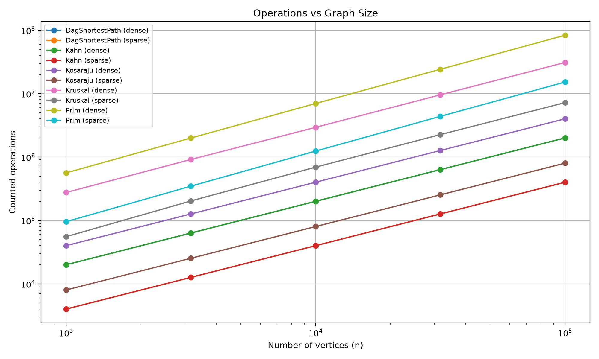
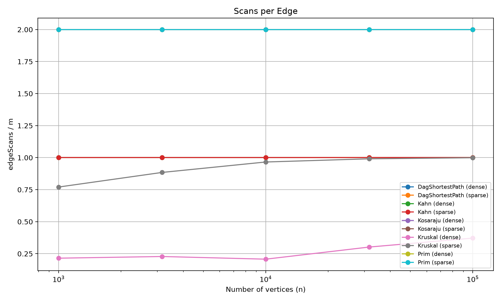
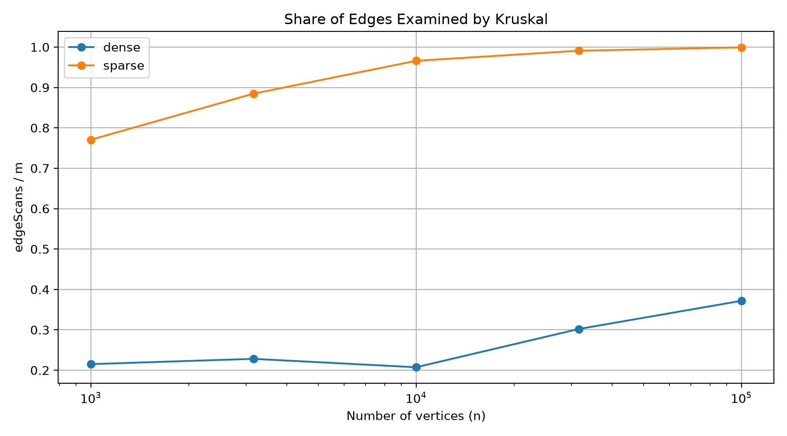

# Assignment 3 — Graph Algorithms Report

**Course:** Design and Analysis of Algorithms  
**Student:** Sayazhan Kanat  
**Topic:** DSU, MST, SCC, Topological Sorting and DAG Shortest Paths

### 1. Introduction

In this assignment, I implemented several graph algorithms using Java 17. The project uses an adjacency list for both directed and undirected graphs. I implemented Disjoint Set Union (DSU), Kruskal, Prim, Kosaraju, Kahn and shortest paths in a DAG.

The main goal was to compare the algorithms, test their correctness and study their complexity using operation counters. I used Random(42) to generate reproducible graphs.

### 2. Complexity Analysis

| Algorithm | Time Complexity | Extra Space | Explanation |
|---|---|---|---|
| DSU find | O(α(V)) amortized | O(V) DSU storage | Path compression makes searches faster. |
| DSU union | O(α(V)) amortized | O(V) DSU storage | Union by rank keeps trees shallow. |
| Kruskal | O(E log E) | O(V + E) | Sorts edges and uses DSU to avoid cycles. |
| Prim | O(E log E) | O(V + E) | Uses a priority queue to select edges. |
| Kosaraju | O(V + E) | O(V + E) | Uses two DFS passes and a reversed graph. |
| Kahn | O(V + E) | O(V) | Processes each vertex and edge once. |
| DAG Shortest Paths | O(V + E) | O(V) | Uses Kahn's order and relaxes each edge once. |

Here, V is the number of vertices, E is the number of edges, and α(V) is the inverse Ackermann function.

The space complexity is measured without counting the input graph. For DAG Shortest Paths, the O(V) extra space includes the distance array, parent array and topological order. The algorithm also uses Kahn's sorting method, which needs O(V) additional space.

### 3. Correctness of Minimum Spanning Tree

Kruskal and Prim use the cut property to build a minimum spanning tree. The cut property says that a minimum-weight edge crossing a cut is safe to add to an MST. Kruskal sorts edges by weight and adds an edge only when it connects two different components. This prevents cycles and helps build a minimum spanning tree. Prim starts from a vertex and selects the cheapest edge connecting the current tree to an unvisited vertex. Both algorithms continue until all reachable vertices are connected. For disconnected graphs, they return a minimum spanning forest. In my tests, both algorithms returned the same total weight on 100 random connected graphs and all 10 benchmark graphs.

### 4. Correctness of DAG Shortest Paths

Negative edge weights are safe in a DAG because there are no directed cycles, so one pass in topological order is enough. In general graphs, negative edges are also possible, but Dijkstra's algorithm is not reliable with negative weights. Bellman-Ford can handle negative edges, although reachable negative cycles make shortest distances undefined.

### 5. Benchmark Results

I tested five algorithms on graphs with 1,000, 3,162, 10,000, 31,623 and 100,000 vertices. For each size, I used two densities: sparse (m = 4n) and dense (m = 20n).

Each algorithm was executed five times, and I recorded the median execution time. The benchmark produced 50 rows in `results/results.csv`.

The results matched all reference values from the assignment. Kruskal and Prim also returned the same MST weight for every graph.

| Graph (n / m) | MST Weight | SCC Count | DAG Distance Sum |
|---|---:|---:|---:|
| 1,000 / 4,000 | 147,970 | 27 | 396,274 |
| 1,000 / 20,000 | 30,363 | 1 | 252,411 |
| 3,162 / 12,648 | 468,911 | 137 | 1,271,911 |
| 3,162 / 63,240 | 97,589 | 1 | 723,157 |
| 10,000 / 40,000 | 1,486,139 | 373 | 3,941,828 |
| 10,000 / 200,000 | 309,550 | 1 | 2,381,342 |
| 31,623 / 126,492 | 4,715,515 | 1,188 | 12,551,891 |
| 31,623 / 632,460 | 968,517 | 1 | 7,376,612 |
| 100,000 / 400,000 | 15,012,094 | 3,923 | 40,096,539 |
| 100,000 / 2,000,000 | 3,056,681 | 1 | 23,512,087 |

### 6. Operation Counters and Complexity

I measured four counters inside the algorithms: `dsuOps`, `edgeScans`, `comparisons` and `maxDepth`.

For Kosaraju, `edgeScans = 2m`, because the algorithm performs two DFS passes. For Kahn and DAG Shortest Paths, `edgeScans = m`, because every edge is processed once. Prim scans both directions of each undirected edge, so its `edgeScans = 2m`.

For example, when n = 1,000 and m = 4,000:

| Algorithm | Measured Counter | Ratio |
|---|---:|---:|
| Kosaraju | 8,000 edge scans | edgeScans / m = 2.00 |
| Kahn | 4,000 edge scans | edgeScans / m = 1.00 |
| DAG Shortest Paths | 4,000 edge scans | edgeScans / m = 1.00 |
| Prim | 8,000 edge scans | edgeScans / m = 2.00 |
| Kruskal | 12,760 DSU operations | dsuOps / m = 3.19 |

These ratios help compare the measurements with theoretical complexity. For the traversal algorithms, the ratios remain constant as the graph size increases.

Kruskal also sorts all edges before selecting them. Its `comparisons` counter includes sorting comparisons, while `edgeScans` counts only the edges examined after sorting. This is why a smaller edge scan count does not always mean less total work.

I also checked the ratios for different graph sizes. The table below uses sparse graphs, where m = 4n.

| n | Kosaraju scans / m | Kahn scans / m | DAG scans / m | Prim scans / m |
|---|---:|---:|---:|---:|
| 1,000 | 2.00 | 1.00 | 1.00 | 2.00 |
| 3,162 | 2.00 | 1.00 | 1.00 | 2.00 |
| 10,000 | 2.00 | 1.00 | 1.00 | 2.00 |
| 31,623 | 2.00 | 1.00 | 1.00 | 2.00 |
| 100,000 | 2.00 | 1.00 | 1.00 | 2.00 |

These ratios stay constant as the graph size increases. This supports the expected linear edge traversal behavior. Kruskal is different because it sorts all edges before examining them, so its sorting comparisons must also be considered when analyzing complexity.

### 7. Log-Log Slope Analysis

I used logarithmic axes to study how the operation counts increase with graph size.

| Algorithm | Sparse Slope | Dense Slope |
|---|---:|---:|
| DAG Shortest Paths | 1.000 | 1.000 |
| Kahn | 1.000 | 1.000 |
| Kosaraju | 1.000 | 1.000 |
| Kruskal | 1.055 | 1.024 |
| Prim | 1.101 | 1.085 |

The traversal algorithms have slopes of 1.000, which agrees with their linear complexity. Kruskal and Prim have slightly higher slopes because of sorting and priority queue operations.

I also calculated the slopes using only `edgeScans`. Kruskal had slopes of 1.055 for sparse graphs and 1.119 for dense graphs. Prim and the traversal algorithms had edge scan slopes of 1.000.

These measurements support the expected growth trends, but they do not prove the complexity bounds by themselves.

### 8. Which Algorithm to Choose

| Situation | Algorithm | Reason |
|---|---|---|
| MST with an edge list | Kruskal | Easy to sort edges and use DSU. |
| MST with an adjacency list | Prim | Can grow the tree using a priority queue. |
| Sparse undirected graph | Kruskal or Prim | Both work well; performance depends on the graph and implementation. |
| Dense undirected graph | Prim | Often useful with an adjacency matrix, although this project uses a priority queue. |
| Directed graph with possible cycles | Kosaraju | Finds strongly connected components. |
| Scheduling jobs without cycles | Kahn | Produces a valid topological order. |
| Scheduling jobs with cycles | Kahn | Detects that a topological order is impossible. |
| Shortest paths in a DAG | DAG Shortest Paths | Runs in O(V + E) and supports negative weights. |

For MST, I would choose Kruskal when the input is already an edge list and Prim when the graph is stored as an adjacency list. For scheduling, I would use Kahn to find a valid order or detect a cycle. If I need to identify groups of mutually dependent jobs, I would use Kosaraju. For shortest paths in a DAG, I would choose topological relaxation because it is linear and supports negative edge weights.

### 9. Experimental Plots

I created three plots using the data from `results/results.csv`. The plots were generated with Python, pandas and matplotlib.

**Plot 1. Operations vs Graph Size**

This plot shows how the counted operations increase when the number of vertices grows. Kahn, Kosaraju and DAG Shortest Paths show linear growth. Kruskal and Prim have additional work because of sorting and priority queue operations.

**Plot 2. Scans per Edge**

This plot compares `edgeScans / m` for each algorithm. Kosaraju stays at 2, while Kahn and DAG Shortest Paths stay at 1. Prim also stays at 2 because each undirected edge is stored in both adjacency lists.

**Plot 3. Share of Edges Examined by Kruskal**

This plot shows the percentage of edges examined by Kruskal after sorting. On sparse graphs, Kruskal examines almost all edges as the graph grows. On dense graphs, it examines a smaller percentage because the MST is completed earlier.

### 10. Execution Time

I measured the execution time using `System.nanoTime()` and recorded the median of five runs.

The measured times generally increased with graph size. However, execution time also depends on the computer, JVM optimizations and background processes. Small graphs sometimes had unstable timing results because their execution time was very short.

For this reason, I used operation counters as the main evidence for complexity analysis instead of relying only on execution time.

### 11. Testing and Validation

I used JUnit 5 to test all implemented algorithms. The project passed 37 tests with zero failures and zero errors using Maven.

The tests included basic graph operations, DSU unions, disconnected graphs, self-loops, parallel edges and cycle detection. I compared Kruskal and Prim on 100 random connected graphs and checked that they produced the same MST weight.

I also compared Kosaraju with a brute-force BFS approach on 30 random directed graphs. DAG Shortest Paths was compared with Bellman-Ford on 100 random DAGs, including negative edge weights.

The iterative Kosaraju implementation successfully processed a path with 100,000 vertices without a stack overflow.

Finally, the benchmark reproduced all 10 reference combinations from the assignment and saved 50 result rows in `results/results.csv`.

### 12. Conclusion

In this assignment, I implemented and tested six graph algorithms in Java. I learned how DSU helps Kruskal avoid cycles, how Prim uses a priority queue, and how Kosaraju and Kahn solve different problems in directed graphs.

The benchmark results matched the reference values, and the operation counters supported the expected complexity trends. I also learned that the best algorithm depends on the graph structure and the problem we need to solve.

Overall, this assignment helped me understand graph algorithms, testing and performance analysis better.